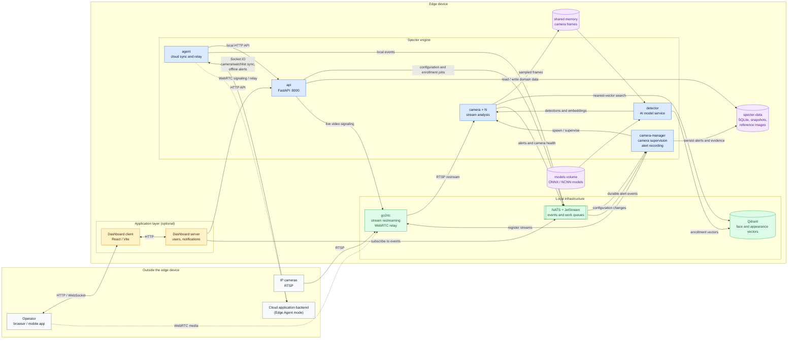

# Specter architecture overview

The diagram below shows the complete deployment topology. Specter runs on the edge device,
while the application server owns users and access control. The dashboard is optional; an
application server can integrate with Specter directly through its HTTP API and NATS events.

## Main paths

- **Video analysis:** cameras → go2rtc → camera processes → shared memory → detector → Qdrant.
- **Configuration:** dashboard/application server → HTTP API → NATS → camera-manager and cameras.
- **Alerts:** camera processes → NATS → camera-manager (durable recording) and application server
  (notifications).
- **Live video:** dashboard/application server negotiates through the API; media is delivered by
  go2rtc over WebRTC.
- **Edge Agent:** the local agent bridges the engine to a cloud backend and queues alerts while
  the cloud connection is unavailable.
