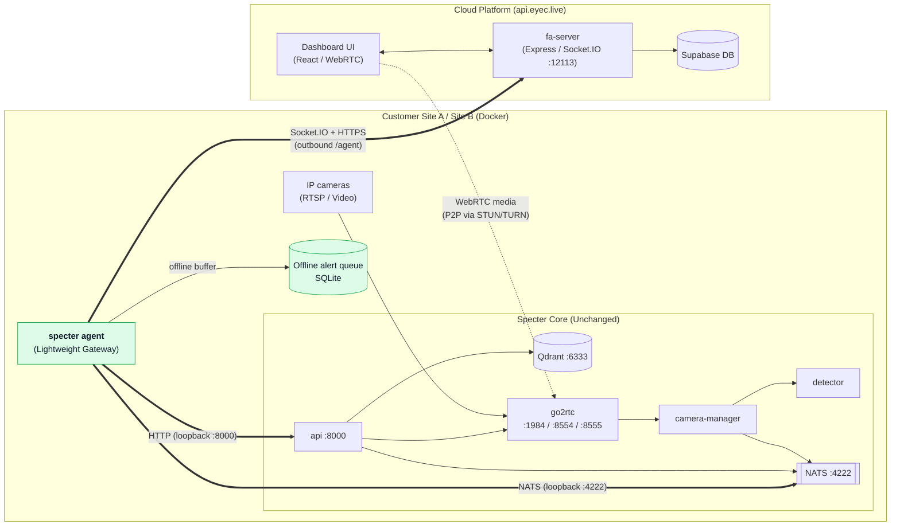
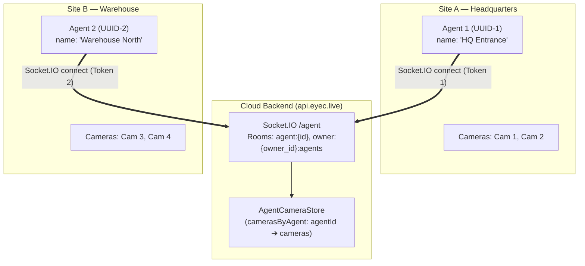

# Specter Edge Agent — Architecture & Implementation Plan

Updated 2026-10-12.

## Executive summary

Turn the existing Specter engine into a **Hybrid VMS Edge Agent** that runs
autonomously at a customer site (behind NAT/firewall), connects outbound to
the fa cloud backend (`fa-server`), and keeps working seamlessly when the
internet connection drops.

Nothing in Specter's core vision engine (api, camera-manager, camera × N,
detector) or its NATS/Qdrant/go2rtc infrastructure changes. A **lightweight
gateway process** — `specter-agent` — runs alongside the edge deployment and
bridges the local engine with the remote cloud backend.

---

## Guiding principles

1. **Specter is untouched.** The edge agent talks to the local Specter API and
   NATS exactly like `fa-server` does in on-premise mode. No modifications to
   `api/`, `camera/`, `camera_manager/`, `detector/`, `vision/`, `inference/`,
   `storage/`, `entities/`, `frame_transport/` or `messaging/`.
2. **fa-server is the authority.** Camera definitions, watchlists, targets
   and user assignments originate in Supabase and Specter. The edge agent
   synchronizes state and acts as a localized execution node.
3. **Local-first autonomy.** Detection, tracking, identification and alerting
   continue uninterrupted during internet outages. Only the uplink to
   `fa-server` pauses; local evidence and event logs are safely stored.
4. **Multi-agent & Multi-site capability.** Multiple edge agents can connect
   to the same cloud tenant simultaneously. Each agent identifies itself with a
   unique `agent_id` and name, managing site-specific cameras while sharing
   the tenant's watchlist catalog.
5. **Outbound-only connectivity.** The agent connects outward via Socket.IO
   and HTTPS (`https://api.eyec.live`), eliminating the need for inbound port
   forwarding, public IP addresses, or VPNs.

---

## Architecture overview



---

## Multi-Agent Architecture

In multi-site deployments, a single organization or owner can operate several
edge agents across distinct physical locations (e.g. "Site A — Headquarters",
"Site B — Warehouse").



### Key Design Pillars for Multi-Agent:

1. **Agent Identity & Authentication:**
   - Every agent is registered via `POST /api/agents` and receives a dedicated,
     random 32-byte secret token.
   - The token hash (`SHA-256`) is stored in Supabase `public.agents`.
   - Each socket connection authenticates into the `/agent` namespace and is
     assigned an `AgentIdentity` (`id`, `owner_id`, `name`).

2. **Scoped Socket.IO Rooms:**
   - `agent:{agent.id}`: Targeted messages to an individual agent instance.
   - `owner:{agent.owner_id}:agents`: Broadcasts to all agents belonging to the
     same tenant (e.g. camera creation, global configuration updates).
   - `agents`: Administrative broadcast room.

3. **Isolated Camera Catalog (`AgentCameraStore`):**
   - The in-memory camera store indexes cameras by `agentId`:
     `Map<agentId, Map<cameraId, ICamera>>`.
   - `agentToOwner` map aggregates all cameras for a given tenant:
     `getCameras(ownerId)` joins cameras across all connected agents without
     destructive overwrites.
   - If an agent disconnects, `markAgentCamerasOffline(agentId)` marks its
     cameras as stopped/offline, keeping them visible in the dashboard catalog
     rather than causing sudden UI flickering.

---

## Implementation Roadmap: 4 Phases

### Phase 1 — Agent Authentication & Camera Sync

- **Server-Side (`dashboard/server`):**
  - Socket.IO `/agent` namespace with bearer token authentication (`agentSocketAuth.ts`).
  - `agent:cameras:sync`: Ingests camera lists from connecting agents into `AgentCameraStore`.
  - `cameras:request_sync`: Pushes the authorized cloud camera catalog down to the agent.
  - Heartbeat tracking with `agent:heartbeat` and `agent:heartbeat:ack`.
  - Scoped command dispatching via `HybridCameraRepository` using `toOwnerAgents()`.
- **Agent-Side (`agent/`):**
  - Python agent supporting CLI commands: `sync`, `start`, `status`, `heartbeat`, `connect`, and `socket-connect`.
  - Configurable `owner_id`, `agent_name`, `api_token_file` (local Specter token), and `cloud_token_file` (cloud agent token).
  - Listens for `cameras:sync`, `cameras:updated`, `agent:camera:start`, and `agent:camera:stop`.

### Phase 2 — Offline Resiliency (Store & Forward Queue)

- **Problem:** If WAN connectivity is interrupted, the edge detection and alerting
  engine continues running, but cloud notifications stall.
- **Solution:**
  - Dedicated local SQLite database (`pending_alerts.sqlite3`).
  - High-water mark tracking for alerts published to local NATS (`EVENTS` stream).
  - When Socket.IO connection is active, alerts are forwarded immediately via `agent:alert`.
  - When offline, alerts and snapshot JPEG payloads are written to the SQLite queue.
  - Upon reconnection, the queue drains chronologically with idempotency checks.

### Phase 3 — WebRTC Signaling Relay (Live Video through NAT)

- **Architecture:**
  - go2rtc runs locally at the edge on ports 1984/8554/8555.
  - Browser requests WebRTC live stream by sending `webrtc:offer` over Socket.IO to the cloud.
  - Cloud relays `webrtc:offer` to the specific agent room `owner:{ownerId}:agents`.
  - Edge agent submits the SDP offer to the local go2rtc / Specter live endpoint:
    `POST /owners/{owner}/cameras/{id}/live/webrtc`.
  - Agent returns `webrtc:answer` and trickle ICE candidates back through Socket.IO.
  - Direct media (P2P via STUN, or relayed via TURN / Cloudflare Calls) flows between
    browser and edge go2rtc.

### Phase 4 — Watchlist & Target Sync (Offline Face Identification)

- **Architecture:**
  - Face vectors are stored locally in Qdrant at each edge site.
  - On agent connection or update, cloud emits `watchlists:sync`.
  - Edge agent reconciles local watchlists and targets with the local Specter API.
  - Photos are downloaded via authenticated cloud endpoints and submitted to the
    local Specter detector for embedding generation and Qdrant enrollment.
  - Local edge performs 100% autonomous identification even with zero WAN access.

---

## Current Status & Verification Matrix

All four phases of the Edge Agent architecture are fully implemented and integrated directly into the Specter engine (`src/specter/agent/`):

| Phase | Capability | Server Status (`dashboard/server`) | Edge Agent Status (`src/specter/agent/`) | End-to-End Status |
|---|---|---|---|---|
| **Phase 1** | Agent Auth (Token) | Implemented (`v0.12.0+`) | Implemented (`cloud_connector.py`) | Verified in Production |
| **Phase 1** | Multi-Agent Scoping | Implemented (`AgentCameraStore`) | Implemented (`agent_name`, rooms) | Verified in Production |
| **Phase 1** | Camera Sync (Socket.IO) | Implemented (`agent:cameras:sync`) | Implemented (`camera_sync.py`) | Verified in Production |
| **Phase 1** | Remote Start/Stop | Implemented (`toOwnerAgents`) | Implemented (`camera_sync.py`) | Verified in Production |
| **Phase 2** | Real-time Alert Relay | Implemented (`AgentAlertStore`) | Implemented (`alert_forwarder.py`) | Verified |
| **Phase 2** | Offline SQLite Queue | Server ingest ready | Implemented (`offline_queue.py`) | Verified (Store & Forward) |
| **Phase 3** | WebRTC Offer/Answer | Implemented (`webrtc:offer/answer`) | Implemented (`webrtc_relay.py`) | Verified with Auto-start |
| **Phase 3** | Cloudflare TURN / STUN | Configured on server | Implemented with auto-negotiation | Verified |
| **Phase 4** | Watchlist Catalog Sync | Implemented (`watchlists:sync`) | Implemented (`watchlist_sync.py`) | Verified |
| **Phase 4** | Offline Vector Index | Specter Qdrant active | Local detector active | Verified Autonomous |

---

## Step-by-Step Production Setup Guide

### 1. Register Edge Agent in Cloud

1. Log into the Cloud Dashboard: `https://www.eyec.live/`
2. Navigate to Agents / Settings, or use the API:
   ```bash
   POST https://api.eyec.live/api/agents
   Authorization: Bearer <USER_JWT>
   Content-Type: application/json
   {"name": "Site 1 - Local Specter Gateway"}
   ```
3. Save the returned token securely into `deploy/secrets/agent.token`:
   ```bash
   chmod 600 deploy/secrets/agent.token
   ```

### 2. Configure Local Agent (`agent/config.json`)

Create `agent/config.json`:
```json
{
  "owner_id": "facealert",
  "agent_name": "Site 1 - Local Specter Gateway",
  "api_token_file": "deploy/secrets/api.token",
  "cloud_token_file": "deploy/secrets/agent.token",
  "cameras": [
    {
      "name": "Local webcam",
      "source_url": "ffmpeg:/dev/video0#video=h264",
      "credentials": null,
      "detection_classes": ["person"]
    }
  ]
}
```

### 3. Start Local Camera & Synchronize

```bash
# 1. Sync camera definitions to local Specter
uv run --project agent python agent/agent.py --config agent/config.json sync

# 2. Start the camera stream locally
uv run --project agent python agent/agent.py --config agent/config.json start

# 3. Check status
uv run --project agent python agent/agent.py --config agent/config.json status
```

### 4. Connect to Cloud via Socket.IO
There are two ways to run the edge agent:
 
#### Option A: Native Specter Agent (Recommended for Production)
 
Run directly with the `specter` CLI using environment variables or `.env`:
 
```bash
SPECTER_AGENT__BACKEND_URL=https://api.eyec.live \
SPECTER_AGENT__AGENT_TOKEN=$(cat deploy/secrets/agent.token) \
SPECTER_AGENT__MODE=cloud \
uv run --env-file .env specter --config config/specter.dev.yaml agent
```
 
Or run the full Docker Compose stack with the agent container:
 
```bash
docker compose --env-file .env \
  -f deploy/compose.infra.yaml \
  -f deploy/compose.specter.yaml \
  -f deploy/compose.agent.yaml up -d
```
 
The native agent automatically connects to local NATS, pushes local cameras, reconciles watchlists,
enqueues alerts in `agent_offline_queue.sqlite3` during disconnections, and handles WebRTC live video relay.
 
#### Option B: Standalone Script (`agent/agent.py`)
 
```bash
uv run --project agent --with 'python-socketio[client]' python agent/agent.py \
  --config agent/config.json \
  --heartbeat-interval 30 \
  socket-connect
```
Once connected, the agent will:
1. Authenticate with the Cloud Socket.IO `/agent` namespace.
2. Push local camera details to `AgentCameraStore`.
3. Receive cloud camera updates and watchlist sync events.
4. Maintain real-time connectivity and heartbeat acknowledgements.
